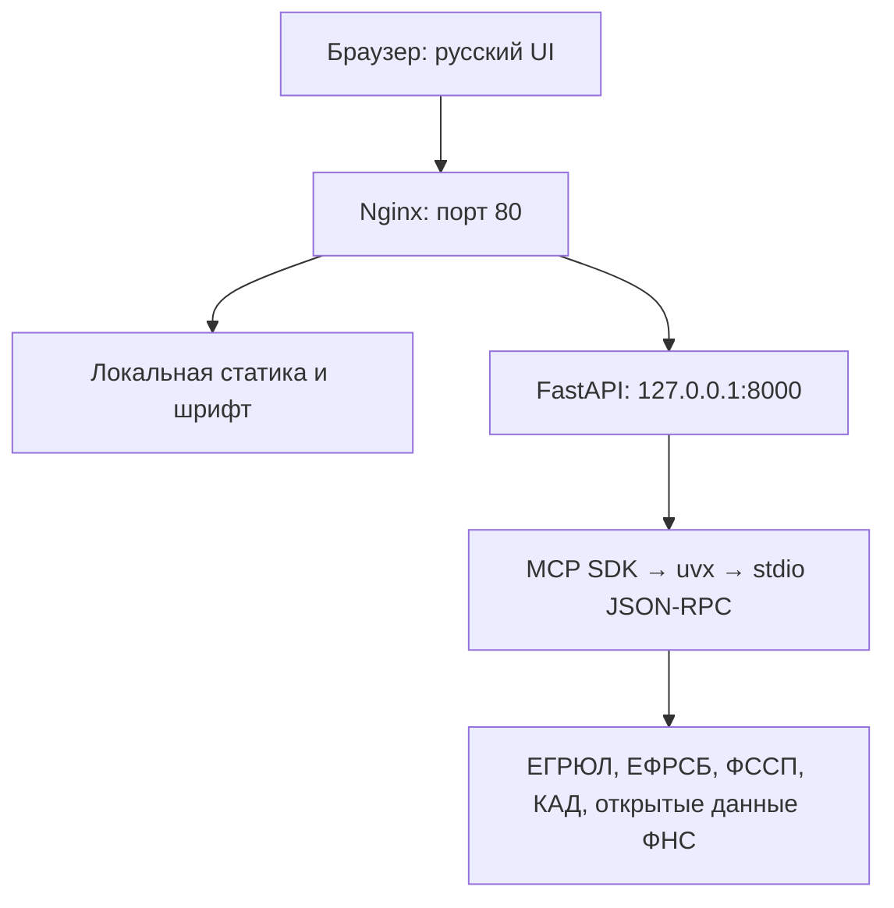

# ФНС РУС

Русскоязычный веб-интерфейс проверки российских контрагентов по ИНН или ОГРН
на базе бесплатного open-source сервера
[atomno-mcp-fns-check](https://github.com/atomno-mcp/mcp-fns-check).

Рабочий адрес в локальной сети: **http://192.168.0.105/**.

## Возможности

- Проверка по ИНН юрлица / ИП и ОГРН / ОГРНИП с проверкой контрольной цифры.
- Основные сведения, регистрация, руководство, адрес, риски, вердикт и ОКВЭД.
- Все поля, возвращённые источником, включая массивы, ошибки и метаданные.
- Копирование каждого поля и полного JSON. На HTTP используется резервный
  механизм копирования; на HTTPS — Clipboard API, если он разрешён браузером.
- Пустые значения отображаются как «—». При копировании сохраняются исходные
  значения: строки без кавычек, числа без округления, `null`, `[]` или `{}`.
- Адаптивная вёрстка для телефона, планшета и настольного браузера.
- Доступ к семи MCP-инструментам через HTTP API, без LLM и без API-ключа.

## Архитектура



Обвязка выполняет MCP-инициализацию, обнаруживает настоящую схему инструмента,
проверяет параметры, вызывает инструмент и завершает подпроцесс.
Один процесс FastAPI допускает одну активную проверку и до 10 вызовов в минуту
суммарно для всех клиентов. Таймаут вызова — 50 секунд, Nginx — 60 секунд.

## Требования

- Ubuntu 24.04, Python **3.11+**; рабочий контейнер использует Python 3.12.
  Python 3.10 не подходит: upstream-пакет требует 3.11 или новее.
- Nginx, uv / uvx, доступ сервера к PyPI и публичным источникам.
- Ориентир: 1 vCPU, 1,5 ГБ RAM. Systemd ограничивает приложение 512 МБ и 80% CPU.
- Современный браузер с поддержкой модулей JavaScript и BigInt.

## Структура

```text
FNSRUS/
├── server.py
├── test_server.py
├── requirements.txt
├── templates/index.html
├── static/
│   ├── style.css
│   ├── app.js
│   └── vendor/       # Иконки, шрифт и лицензии; без CDN
├── systemd/mcp-fns-ui.service
├── nginx/mcp-fns.conf
├── docs/
│   ├── deployment.md
│   └── api.md
├── .env.example
├── .gitignore
├── .gitattributes
├── README.md
└── LICENSE
```

## Установка и запуск

Полная инструкция: [docs/deployment.md](docs/deployment.md).

Краткий ручной запуск после установки uvx и предварительного скачивания MCP-пакета:

```bash
cd /srv/mcp-fns
python3 -m venv .venv
.venv/bin/pip install -r requirements.txt
mkdir -p data
uvx --from atomno-mcp-fns-check==0.1.12 atomno-mcp-fns-check --version
UVX_PATH="$(command -v uvx)" HOST=127.0.0.1 PORT=8000 .venv/bin/python server.py
```

Открыть `http://127.0.0.1:8000/` на той же машине.
Настройки берутся из переменных окружения. `.env` сам по себе не загружается:
systemd читает `/etc/mcp-fns.env`, если файл существует.
`FNS_API_KEY` в шаблоне оставлен пустым для совместимости с заданием и **не используется**.
Не добавляйте туда токен: эта обвязка работает только с публичными источниками.

## Использование

Введите, например, `7707083893` и нажмите «Проверить» либо Enter.
Вердикт учитывает доступность источников, а не только пустой список рисков.
Проверьте разделы «Риски» и «Источники и актуальность» перед принятием решения.
Кнопки «Копировать» и «Копировать всё» возвращаются в исходное состояние через 2 секунды.
Кнопка «Очистить» сбрасывает форму и результат, отменяя ожидание текущего запроса.

Описание HTTP API: [docs/api.md](docs/api.md).

```bash
curl -s http://192.168.0.105/api/check \
  -H 'Content-Type: application/json' \
  -d '{"identifier":"7707083893"}'
```

## Проверка

```bash
cd /srv/mcp-fns
.venv/bin/python -m unittest test_server -v
runuser -u deploy -- env FNS_LIVE_TESTS=1 \
  MCP_FNS_REGISTRIES_DB=/var/lib/mcp-fns/registries.sqlite \
  .venv/bin/python -m unittest test_server -v
```

Первый запуск не обращается к внешним источникам; второй включает один живой
отчёт Сбербанка в окружении серверной установки. Команда `runuser` выполняется
от root. При локальном запуске используйте своего пользователя и доступный ему
каталог `data` вместо `/var/lib/mcp-fns`. Не запускайте живые тесты часто — они учитываются источниками.
Проверяются сохранение JSON, семь имён инструментов, ошибки параметров,
лимит, занятость, таймаут, сбой транспорта и отсутствие повторного использования кэша.

## Ограничения и достоверность

- До 10 запросов в минуту на IP по условиям источников. Один агрегированный
  вызов может выполнять несколько сетевых запросов; лимит обвязки не заменяет
  лимиты самих сайтов и не обходит их.
- В этой обвязке нет постоянного кэша карточек и пакетной проверки: SQLite
  карточек создаётся во временном каталоге для каждого вызова и удаляется после
  завершения. Рабочая база реестров хранится отдельно, это не кэш ответов.
- Сам upstream-пакет умеет постоянный SQLite-кэш; его существующие записи нельзя
  отключить только установкой TTL=0, поэтому используются отдельные временные базы.
- ЕФРСБ может блокировать запросы защитой от роботов, ФССП требует CAPTCHA,
  КАД может отвечать 451. Обвязка не обходит эти защиты.
- Налоговые долги в установленной версии берутся из набора открытых данных ФНС
  `debtam`, а не гарантированно из «Прозрачного бизнеса» в реальном времени.
- Реестры массовых адресов, руководителей и налоговых долгов требуют отдельной
  загрузки через штатный ETL upstream. Тестовые или выдуманные реестры не загружены.
- Адрес, ОКВЭД, учредители и другие поля могут быть пустыми: интерфейс показывает
  всё полученное, но не создаёт отсутствующие сведения и не заменяет выписку.
- Если часть источников не ответила, `manual_review_required` означает необходимость
  ручной проверки, а не технически завершённую проверку всех рисков.
- `192.168.0.105` — локальный IP, не внешний адрес сервера.

## Доступ и Git

Установка предназначена для доверенной локальной сети. Авторизация и TLS не
настроены. Перед внешней публикацией добавьте HTTPS и защиту доступа в Nginx.
Backend в systemd слушает loopback, поэтому прямой доступ к порту 8000 закрыт.

Проект сохранён локально в `C:\_project_\FNSRUS`. Репозиторий должен оставаться
локальным до отдельной команды пользователя. `git remote add` и `git push`
не выполняются автоматически.

## Лицензия

Код обвязки и интерфейса: [MIT](LICENSE).
Lucide: ISC; Golos Text: SIL OFL 1.1. Их лицензии и сведения об источниках
сохранены в [static/vendor/NOTICE.md](static/vendor/NOTICE.md).
Права и условия использования исходных данных определяются их поставщиками.